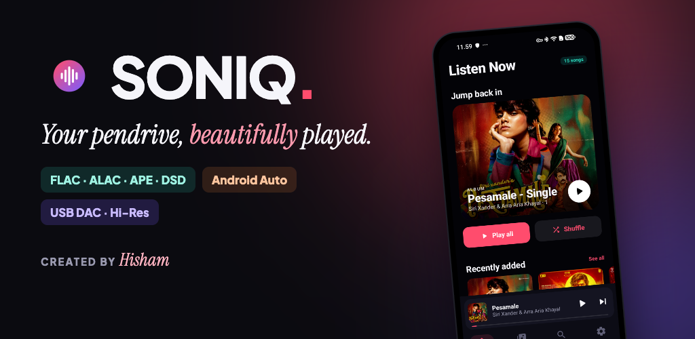

# SONIQ — hi-res music player for Android

A beautiful player for **your own music**: on a USB pendrive, the phone, an SD card, or your NAS through Navidrome.
Every format, real album art, Android Auto, and an Apple Music-style home with mixes made from your library.

A personal project by **Hisham**. Free, no ads, no account, no tracking. Not for sale.

## Download

**[Get the latest APK](https://github.com/hisham1993s-commits/soniq/releases/latest)**, open it on your phone and allow installing from your browser or Files app.
SONIQ checks this page for new versions and offers to install them (Settings → Updates).

## What it does

- **Every format.** FLAC, ALAC, WAV, AIFF, APE, WavPack, TTA, TAK, WMA, DSD (DSF/DFF), MP3, AAC, OGG, Opus and more, up to 32-bit/384 kHz. CUE sheets, M3U playlists and synced lyrics.
- **Your music, wherever it is.** USB-C/OTG pendrives, folders on the phone or SD card, and Navidrome/Subsonic servers (e.g. a NAS reached over Tailscale).
- **Streams that keep up.** Server songs download over four connections, the next three songs are fetched ahead, played songs stay cached, and **Download** saves albums and playlists for offline.
- **Made for you.** Playlists built from your own library and refreshed every week, each with a random album cover from its songs: Road Trip, Late Night Drive, Rain & Chai, Duets, Fresh, Recently Added; decades (90s Tamil Hits…); composer Essentials and Deep Cuts; Best of your favourite singers; and moods (Romance, Kuthu & Energy, Melodies, BGM).
- **Smart shuffle.** With shuffle on, tap a song and what follows matches it: language, composer, singers and era.
- **Android Auto.** Albums, artists, playlists and mixes on the car screen, with artwork and voice search.
- **For audiophiles.** Bit-perfect USB DAC output where the phone allows it, 32-bit float decoding, EQ and effects, ReplayGain, gapless albums, and the Bluetooth codec in use (LDAC, aptX).

## Music on a NAS

1. Run [Navidrome](https://www.navidrome.org) on the NAS and point it at your music folder (read-only is enough).
2. Install [Tailscale](https://tailscale.com) on the NAS and the phone, signed in to the same account.
3. In SONIQ: **Settings → Add music server**, enter `http://<NAS Tailscale IP>:4533` and your Navidrome login.

## Privacy

SONIQ talks only to your own music server, to Deezer/iTunes/MusicBrainz for missing album art and song popularity
(no account, can be turned off), and to GitHub to check for updates.

---

Album artwork shown in the app belongs to its artists and labels. SONIQ is not affiliated with any of them.
